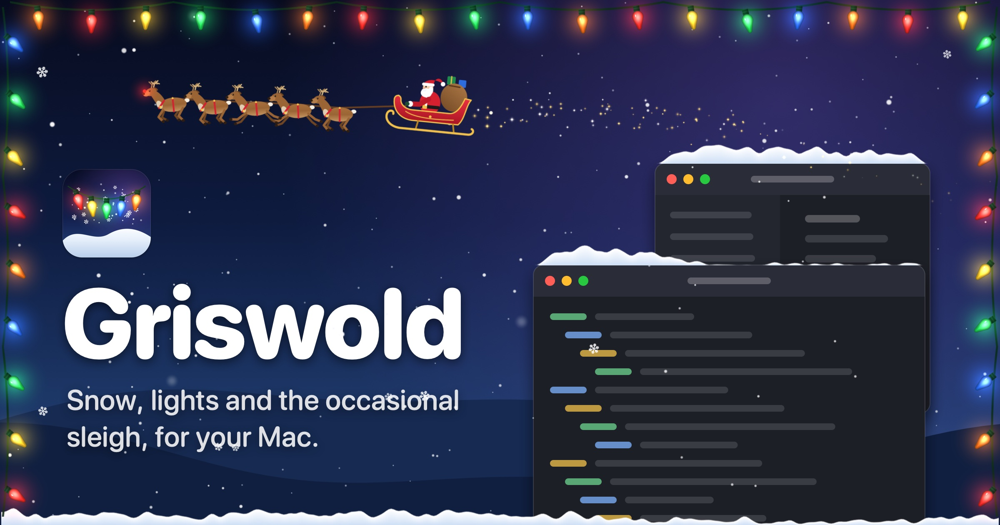

# Griswold

Snow, lights and the occasional sleigh, for your Mac. Free.

**Download:** <https://chonkbase.net/griswold/>



Griswold is a menu bar app that decorates your desktop:

- **Snow that settles.** It piles up along the top of your windows and falls off when you drag one. Close a window and its snow drops onto whatever is below. You choose whether snow falls in front of your windows, behind them (so it never covers what you are doing), or both.
- **Lights around every display.** Five bulb styles, eleven color sets, ten patterns, on whichever edges you pick.
- **Surprises.** Each has its own switch and a Play button:
  - The Squirrel runs across the tops of your windows and leaps between them.
  - The Greased Sled makes three passes at great speed and plows the snow off whatever it crosses.
  - The Griswold Moment: the lights short out, then come back hard enough to brown out the rest of the screen.
  - Frost creeps in from the edges of the screen; wipe it off with the pointer.
  - Santa's sleigh, presents that land on your windows, northern lights, shooting stars, a snowman, gusts of wind, a snowball to the glass, and fireworks at New Year.
- **Easy on the machine.** Drawn with Metal in one pass per display. 60 fps on power, 30 on battery or in Low Power Mode, slower when only steady lights are showing, and nothing at all when the display sleeps, the screen locks, or a full-screen app is in front.
- **No permissions.** It reads where windows are, never what is in them. No Screen Recording, no Accessibility, no account, no tracking. The only network request is an optional daily check of `version.json` on the website.

Requires macOS 13 or later. Universal (Apple silicon and Intel). MIT licensed.

## Building

```sh
swift build                      # debug build
swift test                       # unit tests
swift run Griswold               # run from the terminal

scripts/build-app.sh 1.0.0 1 build            # universal Griswold.app in build/
MAC_SIGNING_IDENTITY=- scripts/sign-and-package.sh build/Griswold.app 1.0.0 build/out   # ad hoc DMG
```

There is no Xcode project. The package is plain SwiftPM, shaders are compiled from source at launch, and all art (sleigh, reindeer, presents, snowman, the app icon) is drawn in code, so the app bundle is one executable and an icon.

### Rendering pictures

The same simulation that runs on screen can render to a file. The images on the website come from this.

```sh
swift run -c release Griswold --snapshot out.png --seconds 120 --scale 2
swift run -c release Griswold --snapshot santa.png --surprise santa --lead 4
swift run -c release Griswold --snapshot icicles.png --preset wonderland
scripts/make-icon.sh             # regenerate Resources/AppIcon.icns
scripts/render-site-assets.sh    # every picture on the website, and the demo film
swift run -c release Griswold --demo-video demo.mp4   # the captioned 45-second film, 1080p60
```

`Griswold --ui-shots <dir>` photographs the real popover and settings window (it opens them on screen for a few seconds).

Options: `--width`, `--height`, `--scale`, `--seconds`, `--preset`, `--style`, `--palette`, `--pattern`, `--accumulation`, `--intensity`, `--layering front|mixed|behind`, `--surprise`, `--lead`, `--stroke x1,y1,x2,y2,...` (a pointer path, for wiping frost), `--crop x,y,w,h`, `--top-only`, `--bottom`, `--no-snow`, `--no-lights`, `--no-windows`, `--no-menu-bar`, `--light-windows`, `--transparent`.

## Layout

| Path | What it is |
| --- | --- |
| `Sources/Griswold` | The executable: starts the app, or the snapshot tool |
| `Sources/GriswoldKit/Snow` | Flakes, clumps, and the height-field piles |
| `Sources/GriswoldKit/Windows` | Window tracking and finding the visible top edges |
| `Sources/GriswoldKit/Lights` | String layout, palettes, patterns |
| `Sources/GriswoldKit/Surprises` | The director (scheduling, Santa, gusts, aurora) and sparks |
| `Sources/GriswoldKit/Overlay` | One transparent window and scene per display; pacing |
| `Sources/GriswoldKit/Render` | Metal renderer, shaders, drawn art, snapshots |
| `Sources/GriswoldKit/UI` | Menu bar popover and settings window (SwiftUI) |
| `site/` | The landing page served at chonkbase.net/griswold |
| `deploy/` | Container and Kubernetes manifests for the site |

## Releasing

Pushing a tag such as `v1.0.0` runs `.github/workflows/release.yml`: it builds the universal app, signs it with the Developer ID certificate, has Apple notarize and staple the disk image, and publishes a GitHub release. It needs these repository secrets: `MAC_CERTIFICATE_P12_BASE64`, `MAC_CERTIFICATE_PASSWORD`, `MAC_SIGNING_IDENTITY`, `APP_STORE_CONNECT_API_KEY_BASE64`, `APP_STORE_CONNECT_KEY_ID`, `APP_STORE_CONNECT_ISSUER_ID`.

Then publish the site with the new disk image:

```sh
deploy/deploy-site.sh 1.0.0
```

## License

MIT. See [LICENSE](LICENSE). The website's heading font is Nunito, under the SIL Open Font License (`site/assets/fonts/OFL.txt`).
